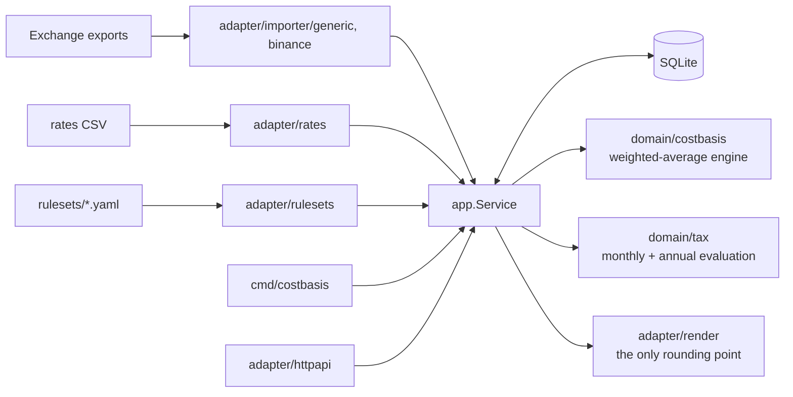

# costbasis-br

Weighted-average cost basis and a monthly tax report for crypto held by
individuals in Brazil. It computes locally with exact arithmetic, from your
exchange exports.

> **Not tax advice.** costbasis-br is a software project. The bundled ruleset
> (`rulesets/br-example.yaml`) was compiled from public sources, and every rule
> in it is marked `verified: false`. Several legal texts could only be
> confirmed through secondary sources. Check every figure against the Receita
> Federal rules in force, or with an accountant, before you file or pay
> anything. Research notes and confidence levels are in
> [ADR 0002](docs/adr/0002-rules-as-dated-data.md).

## Problem

A Brazilian who trades crypto has to do the following:

- compute each gain with the **weighted average cost** (*custo médio
  ponderado*) of the asset, in **BRL**, month by month;
- check whether the month's total sales stayed under the **R$35,000
  exemption**;
- pay a progressive rate by DARF when they did not;
- file a **monthly report** to the Receita Federal when operations outside
  Brazilian exchanges pass a threshold. That report is IN 1.888 until June
  2026 and **DeCripto** from July 2026;
- since 2024, handle holdings on **foreign exchanges** under a separate annual
  regime.

The data comes from several exchanges, and each exports a different CSV. The
quote is often USDT, not BRL. Fees are charged in a third coin. Every swap is
itself a taxable sale.

Most people do this in spreadsheets, and small errors compound: a missed fee,
a swap not treated as a sale, an average cost rounded at every step. Global
tools do not fit. They are built around FIFO and USD, and they do not know the
Brazilian thresholds or reports. They are also hosted, and this is a complete
record of someone's finances.

## What it does

- **Imports** exchange exports into a normalised transaction list: a
  documented generic CSV and Binance's spot trade history. Re-importing the
  same file is a no-op.
- **Values** every non-BRL leg (USDT, USD, fees in BNB, staking income) with a
  daily rates file. A missing rate is an error that names the date and pair.
  The tool never guesses.
- **Computes** weighted-average positions and disposals with `math/big.Rat`.
  Swaps and crypto fees are disposals. Own-wallet transfers are not taxable
  and conserve cost. Selling more than you hold is an error that names the
  transaction, because it means the history is incomplete.
- **Reports** each month:
  - sales and gains;
  - exemption status;
  - estimated tax on domestic disposals;
  - foreign disposals, taxed annually;
  - flags for reporting and payment obligations, with the source of each
    rule;
  - year-end holdings that must be declared.
- **Treats tax rules as dated data.** Rates, thresholds and obligations live
  in YAML with effective dates, so each year is evaluated under the rules in
  force at the time.
- **Keeps everything local.** One SQLite file with mode `0600`, and an HTTP
  API that binds to `127.0.0.1`.

Non-goals for the MVP: filing forms, DeFi and on-chain import, NFTs, and
multiple users.

## Architecture



The dependency rule is `domain` ← `app` ← `adapter` ← `cmd`. The engine and
the tax evaluation are pure: no I/O, no clock, no floats. The app layer
replays the stored history and attaches BRL values from the rate source. It
then runs the engine and evaluates the result against the ruleset. Package
responsibilities are listed in
[docs/ARCHITECTURE.md](docs/ARCHITECTURE.md#package-map).

How correctness is checked:

- **Table tests** for the engine rules and the tax evaluation.
- **Property tests** over hundreds of seeded random histories:
  - buying and then selling everything leaves zero quantity and zero cost;
  - the cost of all disposals plus the remaining cost equals everything paid;
  - own-wallet transfers conserve total cost.
- **Golden-file tests** (`cmd/costbasis/testdata/golden/`) run the real CLI,
  SQLite and embedded ruleset over input CSVs and compare the JSON, CSV or
  table output. Each input is imported twice to prove that re-import is a
  no-op. The quick-start output below is one of these golden files, so it
  cannot drift from the code.

## Quick start

Requires Go 1.24+.

```sh
make build
export COSTBASIS_DB=./data/costbasis.db     # default: ~/.local/share/costbasis/costbasis.db
mkdir -p data

./bin/costbasis import examples/transactions.csv
./bin/costbasis import --format binance examples/binance-trade-history.csv
./bin/costbasis report --year 2026 --rates examples/rates.csv
```

The first import is the reference-format history on a fictional Brazilian
exchange, `brx`. It includes a transfer of ETH to Binance. The second is a
Binance trade-history export. The output:

```text
costbasis-br report 2026, ruleset br-example (UNVERIFIED)
NOT TAX ADVICE. Estimate produced with the unverified example ruleset br-example. Confirm every figure against the Receita Federal rules in force, or with an accountant, before filing or paying anything.

Monthly summary, BRL (domestic disposals are taxed monthly, foreign ones annually)
    MONTH     SALES     GAIN  EXEMPT  TAXABLE  EST. TAX  FOREIGN SALES  FOREIGN GAIN
  2026-01  29985.00  2471.25     yes     0.00      0.00           0.00          0.00
  2026-03  70964.50  5919.57      no  6941.50   1041.23           0.00          0.00
  2026-04      0.00     0.00       -     0.00      0.00       11550.00       1521.02
  2026-05      0.00     0.00       -     0.00      0.00        5455.45        -50.04
  2026-07      0.00     0.00       -     0.00      0.00        9720.00       1696.27
  2026-08      0.00     0.00       -     0.00      0.00          39.90          0.64

Disposals by asset
    MONTH  ASSET    REGIME      QTY  PROCEEDS      COST      GAIN
  2026-01    BTC  domestic     0.05  29985.00  27513.75   2471.25
  2026-03    BTC  domestic      0.1  61969.00  55027.50   6941.50
  2026-03    ETH  domestic      0.5   8995.50  10017.43  -1021.93
  2026-04    ETH   foreign      0.5  11538.45  10017.43   1521.02
  2026-04   USDT   foreign      2.1     11.55     11.55      0.00
  2026-05    BTC   foreign  0.00001      5.45      5.49     -0.04
  2026-05   USDT   foreign     1000   5450.00   5500.00    -50.00
  2026-07    ETH   foreign      0.4   9710.28   8013.94   1696.34
  2026-07   USDT   foreign      1.8      9.72      9.79     -0.07
  2026-08    BTC   foreign  0.00007     39.90     39.26      0.64

Foreign regime (annual): net gain 3167.88, taxable 3167.88, rate 0.15, estimated tax 475.18

Estimated tax for 2026: 1516.41 BRL

Obligations to check
  2026-03  Capital-gains tax payment: estimated tax on domestic disposals; payment code 4600. Due: last business day of the month after the disposal. [unverified rule]
  2026-08  DeCripto monthly declaration (IN RFB 2.291/2025): operations in scope "foreign" total 39900.00 BRL, above 35000.00 BRL. Due: last business day of the following month. [unverified rule]
  2026     Annual tax on assets held abroad: disposals on foreign exchanges are taxed annually at 15%. Due: with the annual income tax return (DAA) for the year. [unverified rule]
  2026     Declare holding in the annual return (DIRPF, Bens e Direitos group 08): year-end cost at or above 5000.00 BRL: [BTC ETH USDT]. Due: annual return deadline of the following year. [unverified rule]

Positions at 2026-12-31 (weighted average cost, BRL)
  ASSET      QTY      COST   AVG COST  DECLARE
    BTC  0.12992  72864.35  560840.10      yes
    ETH    0.608  12181.20   20034.86      yes
   USDT   2896.1  15748.66       5.44      yes
```

How to read it:

- **January** is exempt: sales of R$29,985 are under R$35,000.
- **March** is taxed: sales of R$70,964.50 are over the limit. The ETH loss is
  not offset against the BTC gain, which is the conservative reading recorded
  in ADR 0002. So the taxable gain is R$6,941.50, and 15% of it is R$1,041.23.
- **Binance activity** goes to the annual foreign regime. That includes the
  USDT spent in a swap and the fees paid in coins.
- **August** crosses the DeCripto threshold: R$39,900 of operations abroad.

### CLI

```text
costbasis import [--format generic|binance] <file>...   import exchange exports ("-" reads stdin)
costbasis report --year 2026 [--output table|json|csv] [--ruleset id] [--rates file]
costbasis positions [--date 2026-12-31] [--output table|json|csv] [--rates file]
costbasis serve [--rates file]                           local HTTP API
costbasis version
```

Exit codes: `0` success, `1` data or runtime error (the message names the row,
transaction, date or pair to fix), `2` usage error.

### Generic CSV format

This is the reference format. Convert any other export to it with a
spreadsheet. The header row is required, columns can be in any order, and `#`
starts a comment line.

| Column | Required | Meaning |
|---|---|---|
| `time` | yes | RFC 3339 with offset, e.g. `2026-01-05T14:30:00-03:00` |
| `exchange` | yes | free text; `binance` is treated as foreign by `br-example` |
| `kind` | yes | `buy`, `sell`, `fee`, `deposit`, `withdrawal`, `transfer_in`, `transfer_out`, `income` |
| `asset` | yes | asset bought, sold, moved or received |
| `qty` | yes | positive decimal, `.` separator, no thousands separator |
| `quote_asset`, `quote_amount` | buy/sell | what was paid or received (`BRL`, `USDT`, …) |
| `fee`, `fee_asset` | no | fee, **not** already deducted from `qty` or `quote_amount` |
| `external_id` | no | exchange's trade or transfer ID; it makes deduplication exact |

### Binance export

`--format binance` reads the spot **Trade History** export. In the Binance app
or site, go to Orders → Spot Order → Trade History → Export. Binance's support
page documents the steps and the limits: 10,000 rows and a 6-month range per
export
([Binance FAQ](https://www.binance.com/en/support/faq/detail/e4ff64f2533f4d23a0b3f8f17f510eab)).

> **Format verification status: not confirmed against a live export.** Binance
> does not publish the column layout. The importer follows the layout shared
> by several independent open-source parsers:
> [everytrade-plugins](https://github.com/everytrade-io/everytrade-plugins),
> [cryptotax-reporter](https://github.com/Arnabdaz/cryptotax-reporter),
> [DeclaRenta](https://github.com/GeiserX/DeclaRenta) and
> [cointracer-desktop](https://github.com/cointracer/cointracer-desktop).
> If your export differs, the importer stops with a message that shows the
> expected header.

```text
Date(UTC),Pair,Side,Price,Executed,Amount,Fee
2026-05-20 18:30:00,BTCUSDT,BUY,100000,0.01BTC,1000USDT,0.00001BTC
```

- `Executed`, `Amount` and `Fee` carry the asset as a suffix.
- `Pair` is split into base and quote by matching those suffixes, which also
  handles symbols such as `1INCH`.
- A leading byte-order mark is accepted, and so is the strict `1,234.56`
  thousands form.
- The older layout `Date(UTC),Market,Type,Price,Amount,Total,Fee,Fee Coin` is
  also accepted.
- The export has no trade ID, so rows are identified by their content plus
  their position among identical rows in the same file. Re-importing a file is
  exact. Two *overlapping* exports that each contain the same identical fills
  can be miscounted.
- Deposits, withdrawals, staking and other movements are in the separate
  Transaction History export. That export is not supported yet: add those
  movements with the generic format.

### Rates file

```text
date,pair,rate
2026-04-02,USDT/BRL,5.50
2026-05-20,BTC/BRL,545000
```

The file has one row per calendar date and pair, with BRL as the quote. The
date is taken in `COSTBASIS_TZ`. A rate is needed for every non-BRL quote,
every fee paid in something other than BRL, and every `income` or `fee`
transaction without a quote. Own-wallet transfers need no rates.

## Configuration

Configuration comes only from environment variables. It is read and
validated once at startup, and every problem is reported together.

| Variable | Default | Meaning |
|---|---|---|
| `COSTBASIS_DB` | `$XDG_DATA_HOME/costbasis/costbasis.db` (else `~/.local/share/...`) | SQLite file; created with mode 0600 |
| `COSTBASIS_RATES_FILE` | none | daily rates CSV; `--rates` overrides it per command |
| `COSTBASIS_RULESET` | `br-example` | ruleset ID used when a request names none |
| `COSTBASIS_RULESETS_DIR` | embedded rulesets | directory of `<id>.yaml` files to use instead |
| `COSTBASIS_TZ` | `America/Sao_Paulo` | taxpayer's time zone: month boundaries and rate dates |
| `COSTBASIS_HTTP_ADDR` | `127.0.0.1:8080` | `serve` listen address (the container sets `0.0.0.0:8080`) |
| `COSTBASIS_LOG_LEVEL` | `info` (`warn` for one-shot commands) | `debug`, `info`, `warn`, `error`; JSON logs on stderr |

`make run` loads `.env`. Start from `.env.example`. `make docker` builds a
distroless, non-root image that stores its data in the `/data` volume.

## API

`costbasis serve` exposes the same use cases as the CLI. JSON goes in and out,
and errors look like `{"error":{"code":"snake_case","message":"..."}}`.

| Method and path | Does |
|---|---|
| `POST /v1/imports?format=generic\|binance` | body: the export file (32 MiB max); returns `{format, parsed, inserted, duplicates}` |
| `GET /v1/reports/{year}?ruleset=br-example` | the year report; same numbers as `report --output json` |
| `GET /v1/positions?date=2026-12-31` | holdings at the end of that date |
| `GET /healthz` | the process is alive |
| `GET /readyz` | the database answers (503 otherwise) |
| `GET /metrics` | Prometheus metrics |

```sh
curl -X POST --data-binary @examples/binance-trade-history.csv 'localhost:8080/v1/imports?format=binance'
curl localhost:8080/v1/reports/2026
```

| Status | Code | When |
|---|---|---|
| 400 | `invalid_argument` | bad year, date or unknown format |
| 404 | `ruleset_not_found` | no such ruleset |
| 413 | `too_large` | import body over the limit |
| 422 | `invalid_import` | a row failed to parse or validate; the message names the line |
| 422 | `incomplete_history` | a disposal exceeds the position; the message names the transaction |
| 422 | `rate_not_found` | a needed rate is missing; the message names the date and pair |
| 422 | `no_rule_for_period` | the ruleset does not cover the month |
| 500 | `internal` | anything else; details go to the log only |

There is no authentication. The API is meant for `127.0.0.1` only.

## Metrics

| Metric | Type | Labels |
|---|---|---|
| `costbasis_http_requests_total` | counter | `route` (pattern, not raw path), `method`, `code` |
| `costbasis_http_request_duration_seconds` | histogram | `route` |
| `costbasis_imported_transactions_total` | counter | `format`, `result` (`inserted`, `duplicate`) |

The Go runtime and process collectors are also registered.

## Design decisions

- [0001 Weighted average cost, not FIFO](docs/adr/0001-weighted-average-cost.md):
  the engine's rules for swaps, fees, income and transfers.
- [0002 Tax rules are dated data](docs/adr/0002-rules-as-dated-data.md): the
  ruleset schema, and what the research found, with sources and confidence.
- [0003 Exact arithmetic with big.Rat](docs/adr/0003-exact-arithmetic-big-rat.md):
  rounding happens only at the output edge.
- [0004 Local-first SQLite](docs/adr/0004-local-first-sqlite.md): privacy,
  idempotent imports, and recomputing instead of caching.

Known simplifications:

- There is one cost pool per asset across domestic and foreign custody.
- Foreign losses are not carried forward between years.
- Staking income is not taxed as income, only used as an acquisition cost.
- The reporting-threshold volume counts trades, not transfers.

Each of these is explained in the ADRs.

## Roadmap

- **Phase 2:** importers for the Binance Transaction History, Mercado Bitcoin
  and Coinbase; a rate fetcher from public sources (BCB PTAX for USD, exchange
  closing prices for crypto); separate cost pools by custody if guidance
  appears.
- **Phase 3:** a web UI, and a yearly summary laid out like the annual return
  (Bens e Direitos group 08).

## License

[MIT](LICENSE) © 2026 Pedro Barbosa
