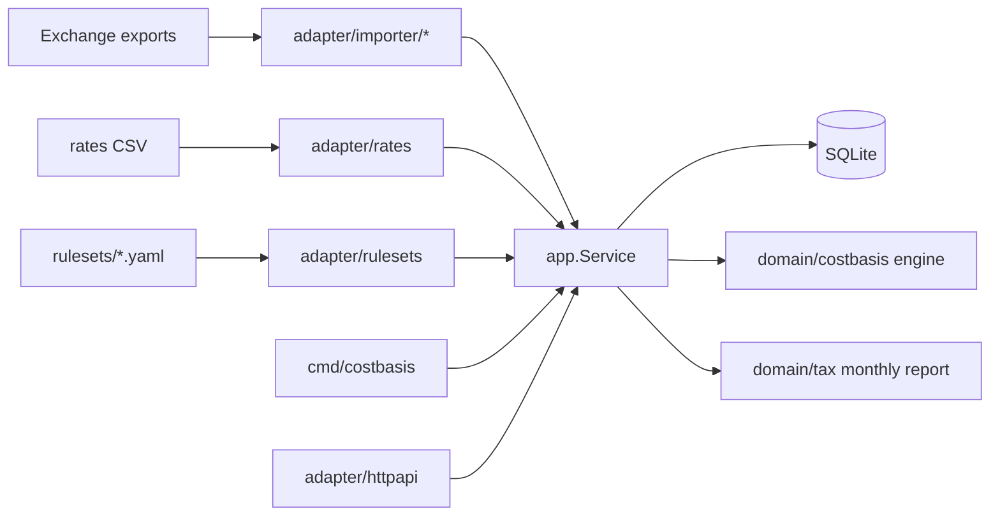

# costbasis-br — Architecture

## Problem

Brazilian crypto investors must compute capital gains with the **weighted average
cost** method, per asset, month by month, in BRL, across several exchanges whose
exports all look different, and must track reporting obligations to the Receita
Federal. Most people do it in spreadsheets and get it wrong; global tools
(FIFO-oriented, USD-first) do not follow the Brazilian method. costbasis-br
imports exchange exports, computes cost basis and realised gains with exact
arithmetic, and produces a monthly report — locally, because this is private
financial data.

## Legal rules are data, not code

Tax rules change (thresholds, rates, reporting obligations). The engine never
hard-codes them. Rules live in versioned YAML **rulesets** with an effective-date
range and a `source` field citing the legal text. The repository ships an example
ruleset whose values are marked `verified: false`. **Nothing here is tax advice;**
the README says so in the first screen.

## MVP scope

- Importers (one adapter each, output = normalised `Transaction`):
  generic CSV (documented schema, the reference format), Binance trade-history
  export. More exchanges plug in as adapters.
- `Transaction{Time, Exchange, Kind(buy|sell|fee|deposit|withdrawal|transfer_in|transfer_out|income), Asset, Qty, QuoteAsset, QuoteAmount, Fee, FeeAsset, ExternalID}`.
- **BRL conversion**: port `RateSource`; MVP reads a daily rates CSV (e.g. USD/BRL,
  USDT/BRL). Missing rate → explicit error naming date and pair, never a guess.
- **Engine** (pure, `math/big.Rat` everywhere):
  - buy/income: position qty += q; total cost += BRL cost (+ fees in BRL).
  - sell: gain = proceeds − fees − q × average cost; position reduced proportionally.
  - own-wallet transfers: move quantity, not a taxable event.
  - fee paid in crypto: disposal of that asset at market value.
  - selling more than held → error with the transaction ID (data is incomplete).
- Monthly report per ruleset: sales volume, realised gain per asset, whether the
  month is within an exemption threshold, estimated tax, reporting-obligation flags.
- Interfaces: CLI (`costbasis import <file> --format binance`, `costbasis report --year 2026`,
  output table / JSON / CSV) and a local HTTP API with the same use cases.
- Storage: SQLite file in the user's data directory.

Non-goals (MVP): filing forms, DeFi/on-chain import, NFTs, multiple users.

## Diagram

## Package map

| Package | Responsibility |
|---|---|
| `cmd/costbasis` | wiring, CLI (`import`, `report`, `positions`, `serve`, `version`); golden tests in `testdata/golden/` |
| `internal/domain` | `Decimal` (immutable `big.Rat`), `Transaction`, `Position`, `Disposal`, sentinel errors |
| `internal/domain/costbasis` | weighted-average engine over pre-valued `Entry`s; pure |
| `internal/domain/tax` | ruleset types and validation, monthly/annual evaluation, reporting flags; pure |
| `internal/app` | use cases: import, recompute, report, positions; ports `Store`, `RateSource`, `Importer`, `RulesetLoader` |
| `internal/adapter/importer/generic` | reference CSV format |
| `internal/adapter/importer/binance` | Binance spot trade-history export (current and legacy layouts) |
| `internal/adapter/rates` | CSV rate source (`date,pair,rate`, BRL quote) |
| `internal/adapter/sqlite` | `Store`; migrations via `PRAGMA user_version` |
| `internal/adapter/rulesets` | YAML loader and validation |
| `internal/adapter/render` | the only rounding point; table / JSON / CSV output shared by CLI and API |
| `internal/adapter/httpapi` | local API, `/healthz`, `/readyz`, `/metrics`, graceful shutdown |
| `internal/platform/config` | environment configuration |
| `internal/platform/logging` | slog JSON logger |
| `rulesets` | shipped YAML rulesets, embedded into the binary |

## Correctness strategy

- Golden-file tests: input CSVs + expected report JSON/CSV/table in `cmd/costbasis/testdata/golden/`,
  run through the real CLI, SQLite and embedded ruleset (`make golden` rewrites them).
- Property tests: buying then selling everything leaves zero position and zero cost;
  total cost is conserved across own-wallet transfers; re-importing the same file is a no-op.
- All amounts printed from `big.Rat` with explicit rounding only at the output edge.

## ADRs to write

0001 weighted average cost (and why not FIFO) · 0002 rules as dated data ·
0003 exact arithmetic with big.Rat · 0004 local-first SQLite.

## Roadmap

Phase 2: more importers (Mercado Bitcoin, Coinbase); rate fetcher from public sources.
Phase 3: web UI; yearly summary for the annual declaration.
